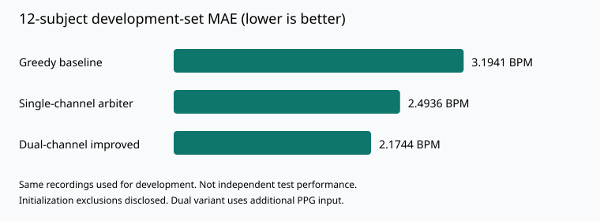

# 腕式 PPG 运动心率估计：基准结果与验证记录

**作者：coco ** · 核验日期：2026-10-11

> 本仓库是个人研究的结果展示与评估说明，不是完整算法开源仓库。
> 核心估计器、具体参数、原始生理数据、逐窗预测及内部实验记录不在此发布。
> 数据来自公开研究基准，结果不代表临床有效性或医疗器械性能。

## 一句话结果

在 IEEE Signal Processing Cup 2015 的 12 名受试者公开训练记录上，
双通道 PPG 改进方案经原始数据全量重跑得到受试者等权平均 MAE **2.1744 BPM**。
1768 个分析窗口中有 1767 个有效输出；有效窗口的误差不超过 5 BPM 比例为 **90.3792%**。

这是**开发集结果**：同一组数据参与了研究、调参和方案选择，不是独立测试集成绩。

## 为什么做这个项目

运动伪影下的心率估计，难点不只是找到一个强谱峰，而是区分生理信号与运动干扰，
并避免错误跟踪持续累积。本项目从 TROIKA 框架的 Python 复现出发，进行真值与通道核对、
失效分析、对照实验和改进验证。

希望展示的是：**把算法假设变成可检验结果，并对输入条件、评价口径和失败边界负责。**
有些看起来更复杂的方案并没有带来改进；记录负结果和限制，与报告最好成绩同样重要。

## 实测结果

| 配置 | 受试者等权 MAE / BPM | 所有有效窗口合并 MAE / BPM | 有效窗口误差 ≤5 BPM |
|---|---:|---:|---:|
| 本项目单通道贪婪基线 | 3.1941 | 3.1947 | 86.4177% |
| 本项目单通道仲裁改进 | 2.4936 | 2.4913 | 90.0396% |
| 本项目双通道改进 | **2.1744** | **2.1701** | **90.3792%** |

相对本项目单通道贪婪基线，双通道方案的开发集 MAE 降低约 **31.9%**。
该变化同时包含算法与额外输入的影响，不能归因成“同输入下纯算法提升 31.9%”。
各配置都使用相同有效窗口；没有按误差大小或置信度丢弃困难窗口。

详细逐受试者汇总见 [subject_metrics.csv](subject_metrics.csv)，结构化指标见 [metrics.json](metrics.json)。

### 输出可用率不是误差达标率

- 全部分析窗口：1768；有效输出：1767；输出可用率：**99.9434%**。
- 仅 DATA_10 的第一个窗口在初始化阶段没有输出，其余窗口均有输出。
- 90.3792% 是**有效窗口中误差 ≤5 BPM 的比例**，不是只保留了 90% 的窗口。
- 若把缺失输出也计为不达标，全部 1768 个窗口的达标比例为 **90.3281%**。
- MAE 不为缺失输出人为指定误差，而是同时披露缺失数。
- 相邻窗口重叠；窗口数不等于独立样本数或独立受试者数。

## 与原论文如何比较

参考文献：Zhilin Zhang, Zhouyue Pi, Benyuan Liu,
“TROIKA: A General Framework for Heart Rate Monitoring Using Wrist-Type Photoplethysmographic Signals During Intensive Physical Exercise,”
IEEE Transactions on Biomedical Engineering, 62(2), 522–531, 2015。
公开预印本：[arXiv:1409.5181](https://arxiv.org/abs/1409.5181)。

论文报告 12 名受试者平均绝对误差 **2.34 BPM**（Table I / Section IV）。
本项目 2.1744 在数值上低于这一报告值，但**不能称为严格同条件超越或当前领域最优**：

1. 论文实验描述单路 PPG；本项目最好结果利用两路 PPG，输入条件不同。
2. 本项目使用发布数据配套的 BPM0 真值；未取得并重跑作者原始实现，不能证明每一窗口、
   初始化及参考处理与论文完全一致。
3. 初始化、SSA 处理及工程容差存在实现差异；不是作者代码的逐位等价复现。
4. 本项目单通道改进为 2.4936，并未低于论文 2.34。
5. 同一组记录参与多轮方案选择，最好数值包含选择偏差；0.17 BPM 左右的跨报告差距不证明统计显著优势。
6. 没有比较后续所有方法，也没有独立设备、受试人群或真实世界数据验证。

### 有限的留一受试者检查

固定已开发的管线，仅对最后一个标量参数进行留一受试者选择，重算结果为 **2.3272 BPM**。
每折在其余 11 人上选参数，再计被留出者的误差。

**这不是完整管线的干净 LOSO 验证**：前面的模型设计与其他参数已经利用了全部 12 人。
因此该结果只能作为末级参数敏感性的补充检查，不能宣传为独立泛化误差。
具体参数不公开，故此处也不构成外部可复现的算法验证。

## 评估协议

- 数据：SPCup 2015 公开训练集，12 条受试者记录。
- 采样率：125 Hz；窗口长度：8 秒；步进：2 秒。
- 改进估计器输入：双路腕式 PPG、三轴加速度；没有向估计器传入 ECG 或真值。
- 评分参考：配套 BPMtrace 中的 BPM0 数组；已与历史实验缓存逐值核对。
- 主要指标：先计算每名受试者的有效窗口 MAE，再对 12 人等权平均。
- 同时披露：合并窗口 MAE、误差阈值达标比例、输出可用率及缺失窗口数。
- 原始数据核验：2026-10-11 对全部 12 条记录全量重跑，当前输出与留存实验缓存一致。

## 目前没有证明的事项

- **严格流式因果性**：当前仲裁预处理包含整段信号的前后向滤波，使用了未来样本；
  初始化检查也可能使用相邻后续窗口。不能把本实现称为严格实时在线算法。
- **嵌入式性能**：未做 MCU 定点部署、功耗、内存峰值和端到端延迟验收。
- **泛化与临床适用性**：尚无独立人群、设备、场景或临床验证；心率结果不证明 HRV、血氧或疾病诊断能力。
- **机制解释的唯一性**：失效分析和消融支持若干解释，但没有直接测量所有物理伪影来源。

## 如何检查这份证据

本包的 [verify_metrics.py](verify_metrics.py) 仅使用 Python 标准库，可重算逐受试者汇总的平均、
窗口数与达标率，并与结构化指标交叉检查。入口为 `verify_metrics.py`。

**它能验证表格算术一致性，不能独立复现未公开的核心估计器。**
原始数据重跑记录与逐窗输出由作者本地保留；未发布第三方审计证明。

## 公开范围与交流

欢迎就 PPG 运动伪影、信号质量评价、基准协议和估计器验证提出具体问题。
本仓库的定位是成果展示，不承诺持续维护开源算法工具箱，也不提供医疗用途承诺。

有关授权和再分发，请先阅读 [RIGHTS.md](RIGHTS.md)。